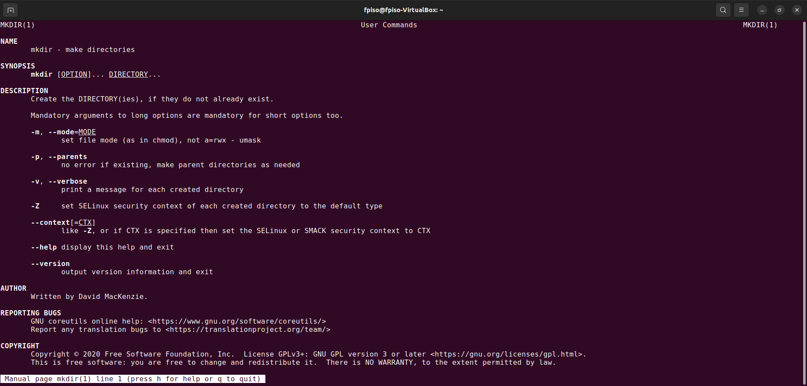
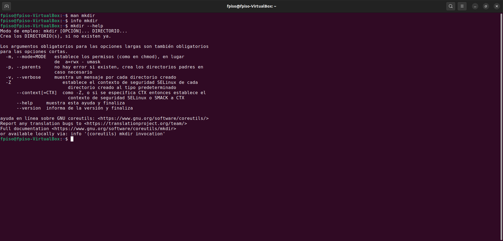
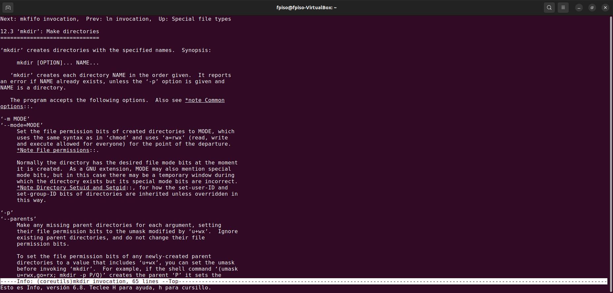
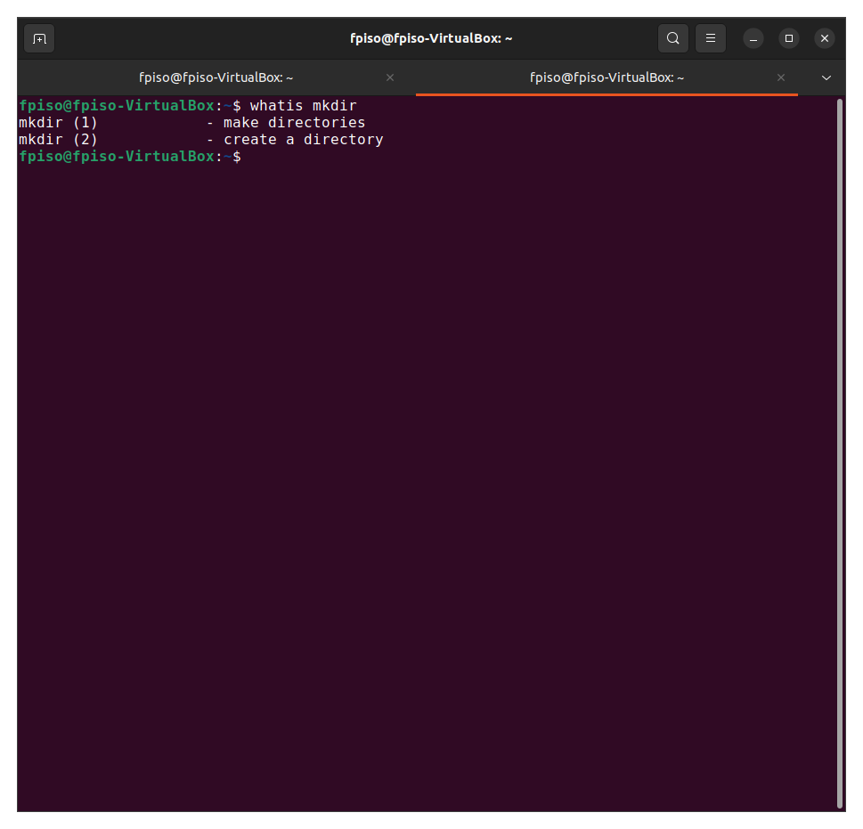
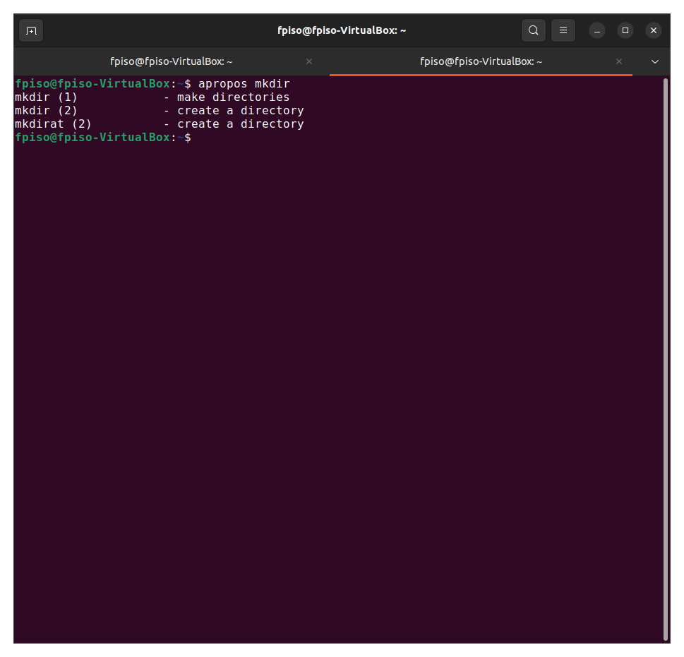

# Comandos de ayuda en la terminal de Linux

## Índice

  - [1. Introducción](#1-introducción)
  - [2. Comando man](#2-comando-man)
  - [3. Comando --help](#3-comando-help)
  - [4. Comando info](#4-comando-info)
  - [5. Comando whatis](#5-comando-whatis)
  - [6. Comando apropos](#6-comando-apropos)
  - [7. Comparativa de comandos](#7-comparativa-de-comandos)
  - [8. Recursos adicionales](#8-recursos-adicionales)
  - [9. Información del proyecto](#9-información-del-proyecto)
---
  
## 1. Introducción

Esta es una **breve guía** de 3 diferentes comandos para obtener *ayuda en la terminal* a la hora de buscar soluciones cuando nos quedamos atascados y no sabemos cómo escribir un comando, qué opciones tiene... 
Es una guía muy sencilla y breve, pero como dice el refrán popular:

> <small> "Un grano no hace granero, pero ayuda al compañero." --- Refrán popular</small>

Una cosa que habría que hacer siempre antes de manejar cualquier *distribución o distro* de Linux, sería actualizar el sistema, y para eso, la secuencia ordenada de comandos a escribir sería:
```
sudo apt update
sudo apt upgrade
sudo apt autoremove
```
Ingresaríamos la contraseña y el sistema se actualizaría y borraría aquellos paquetes innecesarios.

El único propósito de usar `man mkdir` , `mkdir --help` e `info mkdir` es para poder comparar las salidas que ofrecen por pantalla.

---

## 2. Comando man

Este comando sirve para obtener información sobre un comando, abriendo la página del manual. Para salir del manual hay que pulsar la tecla **Q**.
A continuación se ponen 3 ejemplos de este comando:

1. **man mkdir** 



2. **man ls** 

3. **man cd** 

 
---

## 3. Comando help

Este comando también muestra ayuda, pero es una ayuda más concisa o breve. Aporta algunas instrucciones breves sobre el comando que queremos consultar.

1. **mkdir --help** 



2. **ls --help** 

3. **cd --help** 

---


## 4. Comando info

Las páginas que proporciona el comando info son más detalladas que las páginas del manual, y por supuesto que las de help. Aportan mucha información.
La sintaxis de este comando sería:
1. **info mkdir** 



2. **info ls** 

3. **info cd** 


---
## 5. Comando whatis

Muestra una sola línea explicando la función de un comando. Es útil para identificar rápidamente su propósito.

La sintaxis sería ```whatis [nombre_comando]```

**whatis mkdir** 



---

## 6. Comando apropos

Sirve para encontrar comandos relacionados sin saber el nombre exacto. 

La sintaxis sería ```apropos [palabra clave]```

**apropos mkdir**



---

## 7. Comparativa de comandos

A continuación hay una simple comparativa de los comandos indicados en esta guía:

| **Comando** | **Sintaxis** | **Información aportada** |
|:-:|:-|:-:|
| man| man mkdir | media |
|help|mkdir --help|baja|
|info|info mkdir|alta|
|whatis|whatis mkdir|muy baja|
|apropos|apropos mkdir|muy baja|
---


## 8. Recursos Adicionales

*  [Foro de linux.org](https://www.linux.org/forums/#linux-tutorials.122)
*  [Wikipedia: Linux](https://es.wikipedia.org/wiki/GNU/Linux)
*  [Página web de The Linux Foundation](https://www.linuxfoundation.org/)
*  [Linux explicado en menos de 100 segundos](https://www.youtube.com/watch?v=NIQZOviElSU)


---

## 9. Información del proyecto

Esta documentación se ha elaborado utilizando **Markdown**.
El control de versiones se realiza mediante **Git**
y el repositorio remoto se encuentra alojado en **GitHub**.

---


### Autor: José Ramón


